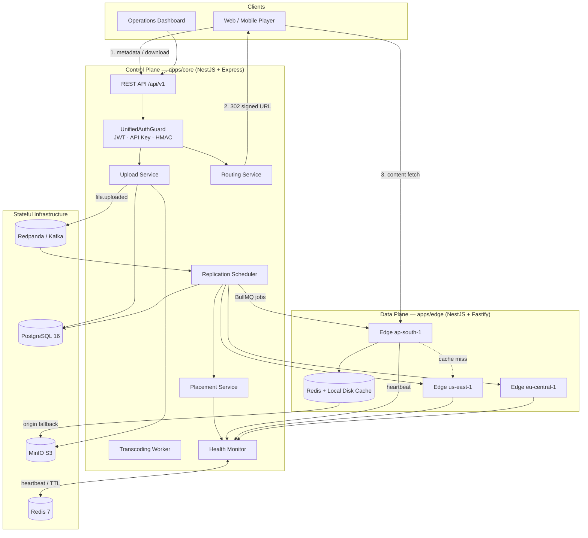
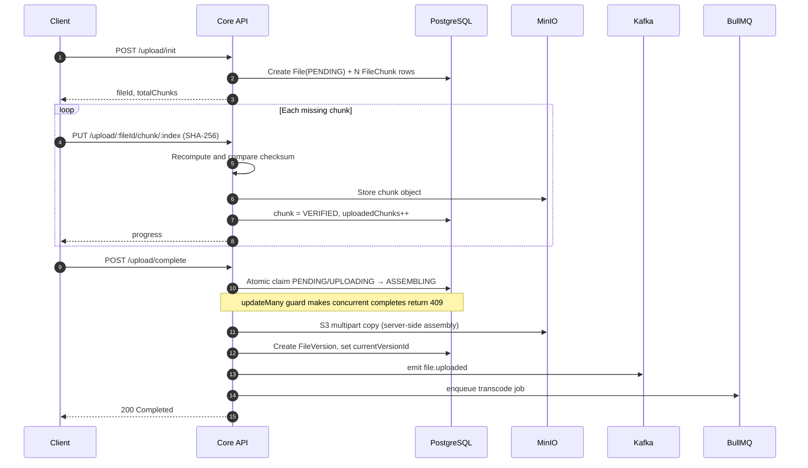
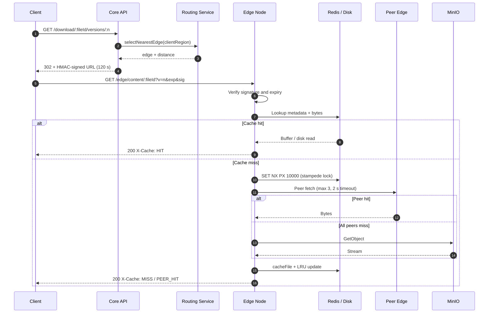
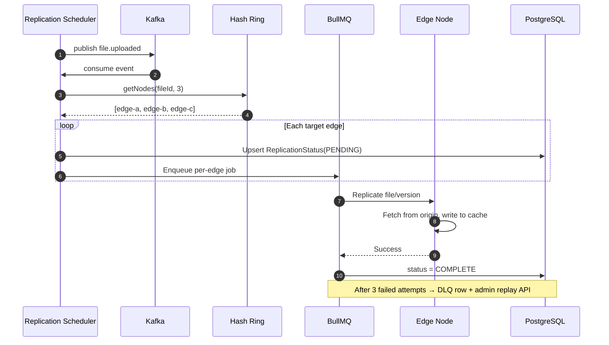
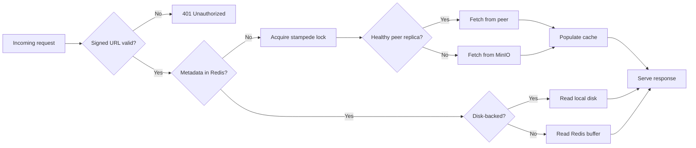
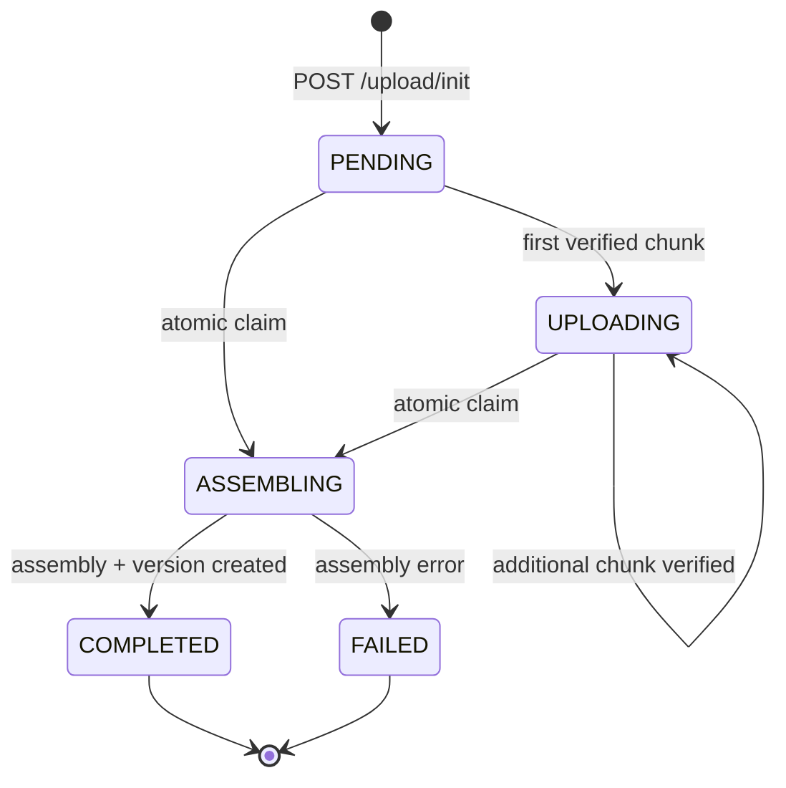
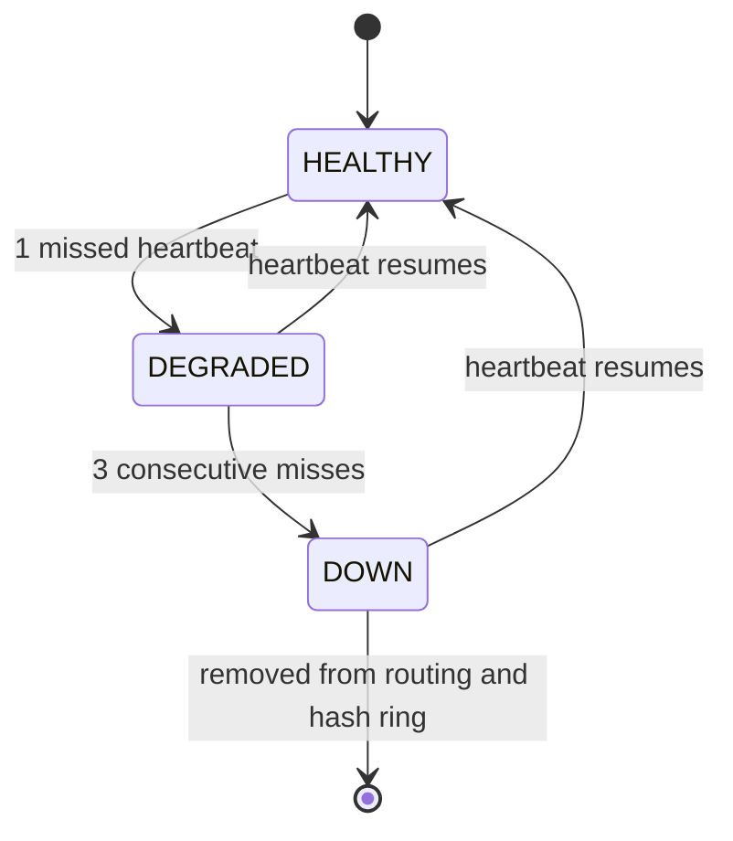
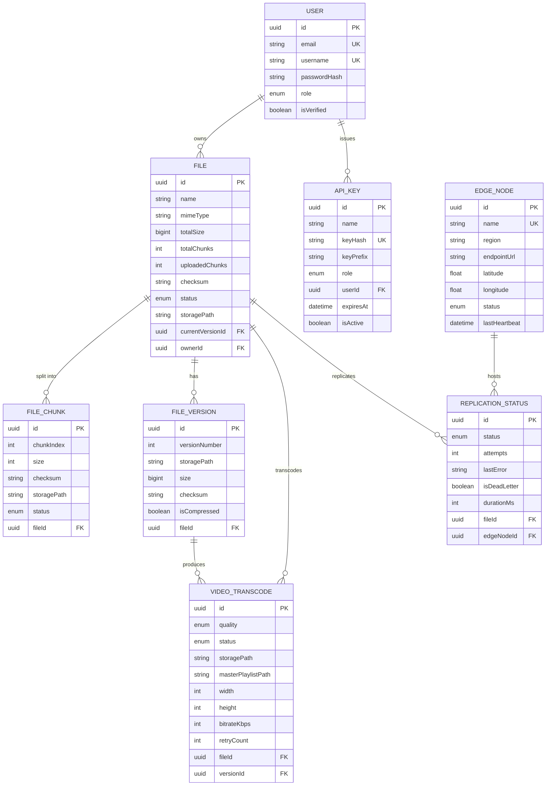

<div align="center">

# Pravah CDN

**A distributed, multi-region content delivery network built from scratch.**

Control plane for metadata, ingestion and orchestration. Data plane at the edge for low-latency delivery.

[](https://github.com/SyncWithRaj/pravah/actions/workflows/ci.yml)


[Overview](#overview) · [Architecture](#architecture) · [Quick Start](#quick-start) · [API](#api-reference) · [Deployment](#deployment) · [Security](#security)

</div>

---

## Overview

Pravah is a working implementation of a CDN built around two independent planes:

| Plane | Service | Responsibility |
| :--- | :--- | :--- |
| **Control plane** | `apps/core` | Identity, resumable ingestion, metadata, transcoding orchestration, replica placement, health monitoring, admin APIs |
| **Data plane** | `apps/edge` | Cache lookup, peer cache-fill, HLS delivery, origin fallback, heartbeat telemetry |

The design goal was not "serve a file" — it was to reproduce the mechanisms that make real CDNs work: **chunked uploads with integrity checks, consistent-hash replica placement, hierarchical caching, signed redirects, health-driven failover, and event-driven invalidation.**

> **Project status:** active development. The stack runs end-to-end on Docker Compose and has a Kubernetes/Terraform deployment path. It is a production-shaped reference implementation, not a hardened commercial CDN. See [Roadmap](#roadmap) for known gaps.

---

## Key Features

| Area | Implementation |
| :--- | :--- |
| **Resumable uploads** | Client-defined chunking, per-chunk SHA-256 verification, server-side S3 multipart assembly, resumable via `GET /upload/status/:fileId` |
| **Video pipeline** | FFprobe inspection → 6 adaptive HLS profiles (1080p → 144p) → 4-second TS segments → `master.m3u8` |
| **Geo-routing** | Region match first, then Haversine great-circle distance across healthy edges |
| **Replica placement** | Consistent hash ring, 100 virtual nodes per edge, replication factor 3 |
| **Edge caching** | Hybrid Redis RAM (< 2 MB) + local NVMe/SSD (≥ 2 MB), LRU eviction via Lua |
| **Stampede protection** | Redis `SET NX PX` mutex with UUID-checked Lua release and exponential-backoff followers |
| **Peer cache-fill** | On miss, query up to 3 peer replicas before falling back to origin |
| **Event bus** | Redpanda (Kafka API) for `file.uploaded`, `cache.invalidate`, `edge.health_changed`, replication events |
| **Background jobs** | BullMQ for transcoding and replication, exponential backoff, dead-letter queue with replay |
| **Health & failover** | 10-second heartbeats → Redis TTL → DEGRADED/DOWN state machine → automatic replica re-placement |
| **Security** | JWT + rotating refresh tokens, hashed API keys, HMAC-signed inter-service calls, signed edge URLs, RBAC |
| **Observability** | Prometheus metrics, Grafana dashboards, Loki logs, Jaeger traces via OpenTelemetry |
| **Deployment** | Docker Compose, Kubernetes manifests, Terraform for AWS EC2 and EKS |

---

## Architecture

### High-level topology



### Control plane vs data plane

| Concern | Core | Edge |
| :--- | :--- | :--- |
| **State** | Authoritative (PostgreSQL) | Disposable (Redis + disk) |
| **Scaling** | Vertical + read replicas | Horizontal, many PoPs |
| **Latency target** | Tens of milliseconds | Sub-millisecond cache hits |
| **Failure impact** | No new uploads or routing decisions | Existing cached content still serves |
| **HTTP engine** | Express | Fastify |
| **Auth** | Issues tokens, verifies all modes | Verifies signed URLs and service HMAC |

---

### Upload pipeline



**Why multipart copy?** Concatenating gigabytes of chunks inside Node would either exhaust heap or require a large temp file. `UploadPartCopy` tells the object store to stitch data server-side; the application only orchestrates.

---

### Download and playback



**Why redirect instead of proxying?** Proxying doubles bandwidth: core would download from MinIO and re-upload to the client. A `302` costs one small request and lets the client pull directly from the edge. The trade-off is that the edge URL must be trusted — hence HMAC signing and a short TTL.

---

### Replication pipeline



---

### Cache resolution path



---

### File lifecycle



---

### Edge health state machine



Heartbeats are posted every 10 seconds and written to Redis with a 15-second TTL. A scanner runs every 5 seconds. Absence of the key — not a timestamp comparison — is what drives the transition.

---

## Tech Stack

| Layer | Technology | Notes |
| :--- | :--- | :--- |
| Runtime | Node.js 22, TypeScript 5.7 | Strict mode, path aliases |
| Control plane | NestJS 11 (Express) | Modules, guards, interceptors, DTO validation |
| Data plane | NestJS 11 (Fastify) | `keepAliveTimeout` 60 s, low per-request overhead |
| Database | PostgreSQL 16 | Relational metadata, transactions, `BigInt` sizes |
| ORM | Prisma 7 | Typed queries, migrations, `PgAdapter` |
| Cache | Redis 7 | Buffers, hashes, sets, sorted sets, Lua, TTL |
| Event bus | Redpanda (Kafka API) | SASL/SCRAM + topic ACLs |
| Queues | BullMQ 6 | Retries, exponential backoff, DLQ |
| Object storage | MinIO | S3-compatible multipart and presigned URLs |
| Auth | Argon2id, JWT, SHA-256 API keys, HMAC-SHA256 | Three orthogonal modes |
| Realtime | Socket.IO | Authenticated telemetry stream |
| Observability | OpenTelemetry, Prometheus, Grafana, Loki, Jaeger | Traces, metrics, logs |
| Reverse proxy | Nginx | Cache, gzip, keep-alive, `stub_status` |
| Containers | Docker, Docker Compose | Multi-stage builds |
| Orchestration | Kubernetes | Deployments, HPA, NetworkPolicy, External Secrets |
| Infrastructure | Terraform (AWS) | EC2 multi-region, EKS |
| CI/CD | GitHub Actions | Format, lint, test, build, Terraform validate, image build |

---

## Repository Structure

```
pravah/
├── apps/
│   ├── core/                     # Control plane (NestJS + Express)
│   │   ├── prisma/               # Schema, migrations, seed
│   │   └── src/
│   │       ├── auth/             # JWT, refresh rotation, API keys, guards
│   │       ├── upload/           # Chunked ingest and assembly
│   │       ├── download/         # Routing, streaming, ETag/Range
│   │       ├── metadata/         # File catalog
│   │       ├── transcoding/      # FFmpeg → HLS pipeline
│   │       ├── replication/      # Kafka consumers, BullMQ, DLQ
│   │       ├── placement/        # Replica selection
│   │       ├── edge-content/     # Origin-side content route
│   │       ├── telemetry/        # Socket.IO gateway
│   │       └── common/           # Redis, Kafka, MinIO, security, routing
│   │
│   └── edge/                     # Data plane (NestJS + Fastify)
│       └── src/
│           ├── content/          # Signed content + HLS delivery
│           ├── cache/            # Hybrid cache, LRU, stampede lock
│           ├── replication/      # Edge-side replication worker
│           ├── heartbeat/        # Signed health telemetry
│           ├── kafka/            # Producer + SASL config
│           └── minio/            # Origin client
│
├── dashboard/                    # Zero-build operations UI (HTML + JS)
├── infra/
│   ├── docker/                   # Compose files, Dockerfiles, deploy scripts
│   ├── nginx/                    # Edge reverse proxy configuration
│   ├── k8s/                      # Kubernetes manifests (00 → 51)
│   ├── terraform/                # AWS EC2 and EKS deployments
│   └── helm/                     # Helm chart scaffolding
├── observability/                # Prometheus, Loki, Promtail, Grafana config
├── benchmarks/                   # k6 scenarios and benchmark reports
├── docs/                         # Architecture, designs, phase reports
├── scripts/                      # RBAC, transcoding, k8s operational scripts
├── AUDIT.md                      # Security audit and remediation record
├── Makefile                      # Developer command center
└── docker-compose.yml            # Includes core + edge stacks
```

---

## Quick Start

### Prerequisites

| Requirement | Version |
| :--- | :--- |
| Node.js | 22.x |
| pnpm | 10.x |
| Docker Engine | 24+ with Compose v2 |
| Disk / RAM | ~4 GB free RAM recommended for the full observability stack |

### 1. Clone and install

```bash
git clone https://github.com/SyncWithRaj/pravah.git
cd pravah
pnpm install
```

### 2. Configure environment

```bash
cp .env.example .env
```

Replace every `replace_with_*` value. Generate strong secrets with:

```bash
openssl rand -hex 32
```

At minimum, set:

```dotenv
POSTGRES_PASSWORD=
REDIS_PASSWORD=
MINIO_ROOT_USER=
MINIO_ROOT_PASSWORD=
MINIO_ACCESS_KEY=
MINIO_SECRET_KEY=
JWT_SECRET=
JWT_REFRESH_SECRET=
INTERNAL_SERVICE_SECRET=
EDGE_URL_SIGNING_SECRET=
KAFKA_ADMIN_PASSWORD=
KAFKA_SASL_PASSWORD=
KAFKA_EDGE_SASL_PASSWORD=
```

> The application fails closed: core will not start without `JWT_SECRET`, and Redis accessors throw in production when `REDIS_PASSWORD` is missing.
>
> `MINIO_ACCESS_KEY` / `MINIO_SECRET_KEY` must match `MINIO_ROOT_USER` / `MINIO_ROOT_PASSWORD`. MinIO creates the root identity from the latter pair, while the application authenticates with the former.

### 3. Start the stack

```bash
docker compose up -d --build
```

This starts PostgreSQL, Redis, Redpanda with SASL provisioning, MinIO, the core API, three edge nodes, the Nginx edge proxy, and the observability stack.

### 4. Apply the schema and seed

```bash
make migrate     # prisma migrate dev
make seed        # edge nodes + demo users
```

> **Note:** database migrations are intentionally a separate step. Run them once after the first boot and after pulling schema changes.

### 5. Open the services

| Service | URL |
| :--- | :--- |
| Core API | http://localhost:3000/api/v1 |
| Health check | http://localhost:3000/api/v1/health |
| Edge node 01 (via Nginx) | http://localhost:8000 |
| Edge node 01 (direct) | http://localhost:3001 |
| Edge node 02 (Virginia) | http://localhost:4001 |
| Edge node 03 (Frankfurt) | http://localhost:5001 |
| Dashboard | http://localhost:8080 |
| MinIO console | http://localhost:9001 |
| Prometheus | http://localhost:9090 |
| Grafana | http://localhost:3002 |
| Jaeger | http://localhost:16686 |
| Loki | http://localhost:3100 |

`5432` is published for local tooling. Redis, Kafka's external listener and the Redpanda admin API are **not published**; they are reachable only on the `pravah-net` bridge.

### 6. Try a request

```bash
# Health
curl -s http://localhost:3000/api/v1/health

# Register, then log in
curl -s -X POST http://localhost:3000/api/v1/auth/register \
  -H 'Content-Type: application/json' \
  -d '{"email":"demo@example.com","username":"demo","password":"Demo1234!@#"}'

curl -s -X POST http://localhost:3000/api/v1/auth/login \
  -H 'Content-Type: application/json' \
  -d '{"identifier":"demo@example.com","password":"Demo1234!@#"}'
```

---

## Configuration

### Required secrets

| Variable | Purpose |
| :--- | :--- |
| `POSTGRES_PASSWORD` | Database authentication |
| `REDIS_PASSWORD` | Redis `AUTH`; required when `NODE_ENV=production` |
| `JWT_SECRET` / `JWT_REFRESH_SECRET` | Token signing; must be distinct |
| `INTERNAL_SERVICE_SECRET` | HMAC key for edge ↔ core service calls |
| `EDGE_URL_SIGNING_SECRET` | HMAC key for signed edge content URLs |
| `MINIO_ROOT_USER` / `MINIO_ROOT_PASSWORD` | MinIO root credentials |
| `MINIO_ACCESS_KEY` / `MINIO_SECRET_KEY` | Application S3 credentials |
| `KAFKA_SASL_PASSWORD` | Core Kafka SCRAM password |
| `KAFKA_EDGE_SASL_PASSWORD` | Edge Kafka SCRAM password |
| `KAFKA_ADMIN_PASSWORD` | Bootstrap superuser password used only by `kafka-init` |

### Tunables

| Variable | Default | Description |
| :--- | :--- | :--- |
| `APP_PORT` | `3000` | Core HTTP port |
| `JWT_EXPIRES_IN` | `15m` | Access token lifetime |
| `JWT_REFRESH_EXPIRES_IN` | `7d` | Refresh token lifetime |
| `MAX_CACHE_SIZE` | `524288000` (500 MB) | Edge cache budget |
| `CACHE_DISK_PATH` | `/tmp/pravah-disk-cache` | Large-object cache directory |
| `DISK_CACHE_THRESHOLD_BYTES` | `2097152` (2 MB) | Redis-RAM vs disk boundary |
| `PEER_FETCH_TIMEOUT_MS` | `2000` | Per-peer fetch timeout |
| `PEER_MAX_ATTEMPTS` | `3` | Peer replicas tried before origin |
| `KAFKA_GROUP_ID` | `pravah-core-cluster-group` | Consumer group |
| `KAFKA_SASL_MECHANISM` | `scram-sha-256` | SASL mechanism |
| `DASHBOARD_ORIGIN` | `http://localhost:8080` | Allowed WebSocket origin |
| `OTEL_EXPORTER_OTLP_ENDPOINT` | `http://jaeger:4318` | Trace exporter |
| `EDGE_NODE_ID` | `edge-node-01` | Edge identity |
| `EDGE_REGION` | `ap-south-1` | Edge region label |

---

## API Reference

All routes are prefixed with `/api/v1`. Authentication is one of: `Authorization: Bearer <jwt>`, `x-api-key: <key>`, or the HMAC triplet `x-service-id`, `x-service-timestamp`, `x-service-signature`.

### Authentication

| Method | Path | Auth | Description |
| :--- | :--- | :--- | :--- |
| `POST` | `/auth/register` | Public | Create account (role always `USER`) |
| `POST` | `/auth/login` | Public | Returns access + refresh token |
| `POST` | `/auth/refresh` | Refresh token | Rotate token pair; reuse revokes the family |
| `GET` | `/auth/me` | JWT | Current user |
| `POST` | `/auth/api-keys` | JWT | Issue a machine key (one-time plaintext) |
| `GET` | `/auth/api-keys` | JWT | List caller's keys |
| `DELETE` | `/auth/api-keys/:id` | JWT | Revoke a key |

### Upload

| Method | Path | Auth | Description |
| :--- | :--- | :--- | :--- |
| `POST` | `/upload/init` | JWT / API key | Create upload session and chunk slots |
| `POST` | `/upload/:fileId/versions` | Owner | Start a new version |
| `PUT` | `/upload/:fileId/chunk/:index` | Owner | Upload one chunk (multipart, checksum required) |
| `GET` | `/upload/status/:fileId` | Owner | Verified chunk indices for resume |
| `POST` | `/upload/complete` | Owner | Assemble, create version, emit event |

### Download

| Method | Path | Auth | Description |
| :--- | :--- | :--- | :--- |
| `GET` | `/download/:fileId` | Owner | Current version; redirects to nearest edge |
| `GET` | `/download/:fileId/versions/:n` | Owner | Specific version; supports `Range` and `If-None-Match` |
| `GET` | `/download/:fileId/signed` | Owner | MinIO presigned URL |

### Metadata

| Method | Path | Auth | Description |
| :--- | :--- | :--- | :--- |
| `GET` | `/metadata/files` | JWT | Caller's files |
| `GET` | `/metadata/files/:fileId` | Owner / admin | File detail |
| `GET` | `/metadata/files/:fileId/versions` | Owner / admin | Version history |
| `DELETE` | `/metadata/files/:fileId` | Owner / admin | Delete file and objects |

### Edge content

| Method | Path | Auth | Description |
| :--- | :--- | :--- | :--- |
| `GET` | `/edge/content/:fileId` | Signed URL / HMAC | Binary content with hybrid cache |
| `GET` | `/edge/content/:fileId/hls/*` | Signed URL / HMAC | HLS playlist or segment |
| `POST` | `/edge/content/:fileId/purge` | HMAC (internal) | Evict all versions from cache |

### Internal (service-to-service)

| Method | Path | Auth | Description |
| :--- | :--- | :--- | :--- |
| `GET` | `/internal/metadata/files/:fileId` | HMAC | Origin metadata for an edge |
| `GET` | `/internal/metadata/files/:fileId/versions/:version` | HMAC | Version metadata |
| `GET` | `/internal/placement/:fileId/v/:version` | HMAC | Replica list ordered by distance |
| `POST` | `/admin/health/heartbeat` | HMAC | Edge heartbeat |

### Administration

| Method | Path | Role | Description |
| :--- | :--- | :--- | :--- |
| `GET` | `/admin/health/nodes` | USER+ | Edge inventory |
| `GET` | `/admin/health/nodes/healthy` | USER+ | Healthy edges only |
| `GET` | `/admin/replication/status/:fileId` | ADMIN | Replication state per edge |
| `GET` | `/admin/replication/failed` | ADMIN | Failed jobs |
| `POST` | `/admin/replication/retry` | ADMIN | Retry a replication |
| `POST` | `/admin/replication/failover/:edgeId` | ADMIN | Force failover re-placement |
| `GET` | `/admin/dlq` | ADMIN | List dead-letter records |
| `GET` | `/admin/dlq/:id` | ADMIN | Single record |
| `POST` | `/admin/dlq/replay` | ADMIN | Replay one |
| `POST` | `/admin/dlq/replay-all` | ADMIN | Replay all |
| `DELETE` | `/admin/dlq/:id` | ADMIN | Purge record |
| `POST` | `/admin/cache/purge` | ADMIN | Invalidate cache for a file |
| `GET` | `/admin/transcoding/status/:fileId` | ADMIN | Transcode state |
| `GET` | `/metrics` | Public | Prometheus exposition |

### Role hierarchy

```
ADMIN (4)  →  STREAMER (3)  →  VIEWER (2)  →  USER (1)
INTERNAL is a non-human role granted only to signed service identities.
```

Higher roles inherit every permission of lower roles. Ownership is checked regardless of role, except for `ADMIN`.

---

## Core Subsystems

### Authentication and authorization

Three independent mechanisms are unified behind one guard (`UnifiedAuthGuard`):

| Mode | Use case | Validation |
| :--- | :--- | :--- |
| **JWT** | Human sessions | Signature, expiry, user existence, role from database |
| **API key** | CI/CD and machines | SHA-256 hash lookup, active flag, expiry, `lastUsedAt` update |
| **HMAC** | Edge ↔ core | `HMAC-SHA256(secret, serviceId:method:path:timestamp:bodyHash)`, ±5 minute window |

Refresh tokens carry a `jti` and belong to a **token family**. On rotation the old token is atomically marked `consumed:<familyId>`. Presenting a consumed token revokes the entire family — the standard detection mechanism for stolen refresh tokens.

### Resumable upload

- The server is the source of truth for progress; the client only persists `fileId`.
- Every chunk is SHA-256 verified **before** it is written to object storage.
- Completion is guarded by a conditional `updateMany`: only one request can move the file into `ASSEMBLING`.
- Assembly uses S3 multipart copy, so Node never holds the full object.
- A failed assembly moves the file to `FAILED` rather than leaving it stuck.

### Video transcoding

1. `ffprobe` reads resolution, duration and audio layout.
2. Profiles at or below the source resolution are selected — no upscaling.
3. Six ladder rungs: 1080p / 720p / 480p / 360p / 240p / 144p.
4. FFmpeg emits 4-second MPEG-TS segments plus per-quality playlists.
5. A `master.m3u8` is written at the top level.
6. Every artefact is uploaded to MinIO under `hls/{ownerId}/{fileId}/{versionId}/`.

### Consistent hashing and placement

- Ring space: `[0, 2^32)` using MD5 of `nodeId:vnode:i`.
- 100 virtual nodes per physical edge.
- `getNodes(fileId, 3)` walks clockwise from the key hash, deduplicating physical nodes.
- Adding or removing an edge moves roughly `1/N` of keys instead of rehashing everything.
- Placement sorts responsible replicas by Haversine distance from the requesting edge.

### Replication and DLQ

- Triggered by `file.uploaded` and `file.version_created`.
- One BullMQ job per target edge, plus a shared core queue for origin-side cache warming.
- Retries: 3 attempts with exponential backoff.
- After exhaustion the record is marked dead-letter with the error and a payload snapshot.
- Admin APIs support inspect, replay-one and replay-all.

### Edge caching

| Object size | Storage | Latency |
| :--- | :--- | :--- |
| `< 2 MB` | Redis binary buffer | ~0.8–2.5 ms |
| `≥ 2 MB` | Local NVMe/SSD, metadata in Redis | Disk read |

- LRU is a Redis sorted set scored by access time.
- Eviction runs a Lua script so size accounting and deletion are atomic.
- Stampede lock: `SET lock:stampede:{fileId}:v{version} <uuid> NX PX 10000`.
- Followers poll with exponential backoff instead of hammering the origin.
- Release compares the UUID inside Lua, so an expired lock cannot be deleted by the wrong owner.

### Health and failover

- Edge posts a signed heartbeat every 10 seconds.
- Core writes `edge:{id}:heartbeat` with a 15-second TTL.
- Scanner runs every 5 seconds; 1 miss → `DEGRADED`, 3 misses → `DOWN`.
- `DOWN` removes the node from routing candidates and triggers re-placement of its replicas.
- Recovery is automatic on the next heartbeat.

---

## Data Model



Key constraints:

- `file_chunks(fileId, chunkIndex)` — unique, one slot per chunk.
- `file_versions(fileId, versionNumber)` — unique, sequential versions.
- `video_transcodes(fileId, versionId, quality)` — unique, one row per ladder rung.
- `replication_status(fileId, edgeNodeId)` — unique, one record per file per edge.
- Cascading deletes from `files` to chunks, versions, transcodes and replication rows.

---

## Deployment

### Docker Compose

```bash
docker compose up -d --build     # full stack
docker compose logs -f core-app
docker compose down              # stop, keep volumes
docker compose down -v           # stop and delete data
```

The root `docker-compose.yml` includes both stacks:

- `infra/docker/docker-compose.core.yml`
- `infra/docker/docker-compose.edge.yml`

### Kubernetes

Manifests live in `infra/k8s`, ordered by numeric prefix:

```bash
kubectl apply -f infra/k8s/
kubectl get pods -n pravah-system -o wide
kubectl get svc,hpa -n pravah-system
```

Included: StatefulSets for PostgreSQL, Redis, Redpanda and MinIO; Deployments for core and edge; HPAs; Ingress; NetworkPolicy; External Secrets integration.

> The `02-secrets.yaml` manifest uses the External Secrets Operator with AWS Secrets Manager. Install the operator and create the `SecretStore` before applying, or use the commented fallback in `infra/k8s/kustomization.yaml`.

### Terraform (AWS)

```bash
cd infra/terraform/ec2-multi-region
terraform init
terraform plan  -var-file=terraform.tfvars
terraform apply -var-file=terraform.tfvars
```

Two reference topologies are provided:

| Path | Topology |
| :--- | :--- |
| `infra/terraform/ec2-multi-region` | Central core node + edge nodes across regions |
| `infra/terraform/eks-multiregion-deployment` | EKS clusters with ECR and multi-region edge pools |

Always review `terraform plan` before applying. State is not committed.

---

## Security

The repository includes `AUDIT.md`, a documented audit with 21 findings and their remediation status.

| Control | Implementation |
| :--- | :--- |
| Password storage | Argon2id, per-password salt |
| Access tokens | JWT, 15-minute lifetime |
| Refresh tokens | 7-day lifetime, `jti`-tracked, rotating, family revocation on reuse |
| API keys | SHA-256 digest only; plaintext shown once |
| Service auth | HMAC-SHA256 over method, path, timestamp and body hash |
| Edge URLs | HMAC-signed, 120-second expiry |
| Authorization | Hierarchical RBAC + explicit ownership checks |
| Input validation | Global `ValidationPipe` with `whitelist` and `forbidNonWhitelisted` |
| Rate limiting | Redis-backed global guard, per-route overrides |
| Path safety | `path.resolve` containment plus identifier regex allow-lists |
| Redis | `requirepass`, not published to the host |
| Kafka | SASL/SCRAM, least-privilege topic ACLs, external listener unpublished |
| Secrets | `.env` locally, AWS Secrets Manager + External Secrets in Kubernetes |
| Browser | CSP meta policy, output escaping in the dashboard |

**Reporting a vulnerability:** please open a private security advisory rather than a public issue.

---

## Testing and Quality

```bash
pnpm -r test                       # Jest suites
pnpm --filter core exec tsc --noEmit
pnpm --filter edge exec tsc --noEmit
pnpm run format:check
pnpm run lint
```

| Gate | Tool | Scope |
| :--- | :--- | :--- |
| Formatting | Prettier | Core source and tests |
| Linting | ESLint 9 + typescript-eslint | Core source |
| Unit tests | Jest 30 | 94 tests across core and edge |
| Type checking | `tsc --noEmit` | Both applications |
| Build | Nest CLI | Both applications |
| Terraform | `fmt`, `init -backend=false`, `validate` | All modules |
| Containers | Docker buildx | Core, edge, nginx |

CI runs on every push and pull request to `main`.

---

## Benchmarks

Load scenarios live in `benchmarks/k6`:

| Scenario | What it measures |
| :--- | :--- |
| `01_edge_cache_hit.js` | In-memory cache delivery |
| `02_geo_routing_throughput.js` | Haversine routing overhead |
| `03_origin_cache_fill.js` | Miss path and tiered fill |
| `04_chunked_upload_concurrency.js` | Parallel chunk ingestion |
| `05_byte_range_streaming.js` | HTTP 206 seeking |
| `06_cache_invalidation_under_load.js` | Purge correctness under traffic |

```bash
bash benchmarks/run_all.sh
```

The multi-region EKS report in `benchmarks/reports/` records a **106,000 RPS sustained peak** across Mumbai, Virginia and Frankfurt with a 0.0000% error rate during a 2,000-VU distributed test. Treat published numbers as environment-specific and reproduce them before quoting them.

---

## Roadmap

| Priority | Item |
| :--- | :--- |
| High | Transactional outbox for Kafka publishes (currently fire-and-forget) |
| High | Integration tests with real PostgreSQL, Redis and MinIO (Testcontainers) |
| High | Per-version replication state (current unique key is `fileId + edgeNodeId`) |
| Medium | Dashboard refresh-token flow and strict CSP without inline handlers |
| Medium | `prisma migrate deploy` job in Compose and Kubernetes |
| Medium | Helm chart templates (current chart has no `templates/` directory) |
| Low | Prefix-aware Nginx cache keys so signed URLs share a cache entry |
| Low | Nonce cache for inter-service HMAC replay protection |
| Low | Range-request support on the edge content route |

---

## Documentation

| Document | Contents |
| :--- | :--- |
| [`AUDIT.md`](./AUDIT.md) | Security audit, findings V-01…V-21, remediation |
| [`docs/architecture.md`](./docs/architecture.md) | System architecture |
| [`docs/architecture_2.0.md`](./docs/architecture_2.0.md) | Revised architecture |
| [`docs/designs/`](./docs/designs) | Consistent hashing, tiered cache, transcoding, routing, EKS |
| [`docs/reports/`](./docs/reports) | Phase-by-phase implementation reports |
| [`apps/core/README.md`](./apps/core/README.md) | Control plane internals |
| [`apps/edge/README.md`](./apps/edge/README.md) | Data plane internals |
| [`infra/k8s/README.md`](./infra/k8s/README.md) | Manifest order and rollout |
| [`benchmarks/README.md`](./benchmarks/README.md) | Load suite and reports |

---

## Contributing

1. Fork the repository and create a branch: `feat/your-feature` or `fix/your-bug`.
2. Install dependencies with `pnpm install`.
3. Make the change and add or update tests.
4. Run the full gate:

   ```bash
   pnpm run ci
   ```

5. Open a pull request describing the problem, the approach and how you verified it.

Commit messages follow Conventional Commits (`feat:`, `fix:`, `docs:`, `refactor:`, `chore:`).

---

<div align="center">

**Pravah**

Built to understand how content actually reaches users at scale.

</div>
